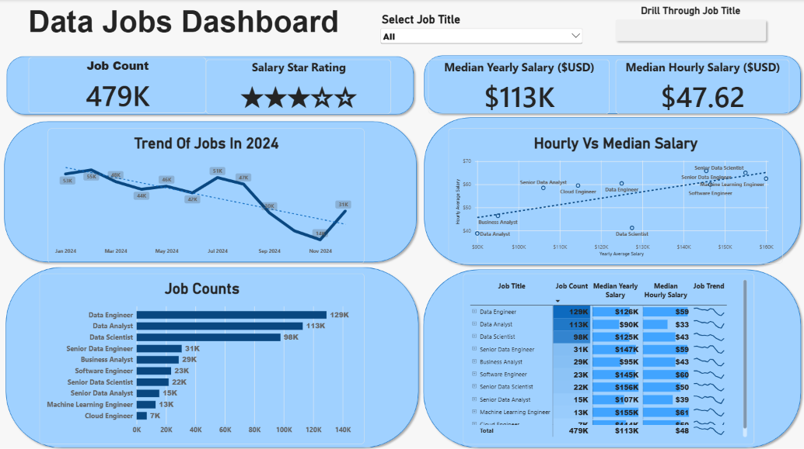
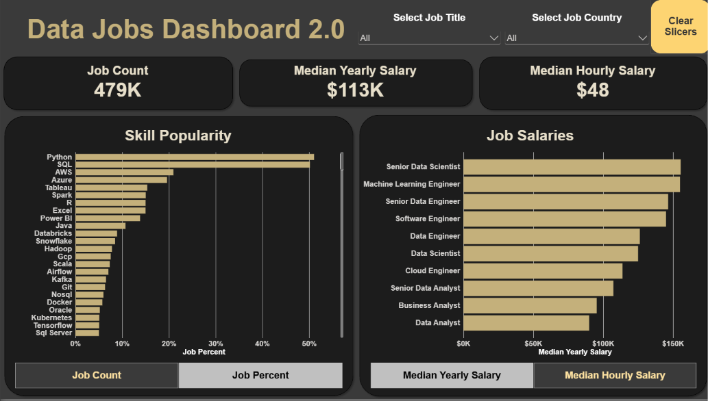

# My Power BI Dashboard Portfolio 📊
This repository is a collection of Power BI Dashboards that I have developed.It tracks my journey in using Power BI, from foundational reports to more advanced interactive analyses,all aimed at turning data into clear, actionable insights.

# Featured Dashboard

Explore the dashboards below. Each has its own dedicated README with more details on the build process and specific features.

## Data Jobs Dashboard (V1- Comprehensive Exploration)

**Key Power BI Skills Utilized:**
* 🎨 Dashboard Layout & Design
* ⚙️ Power Query (ETL & Data Shaping)
* 🔗 Basic Data Modeling (Table Relationships)
* 🧮 Implicite measures & Standard Aggregations
* 📈 Core Charts (Column, Bar, Line, Area charts)
* 🗺️ Map Visualizations for Geospatial data.
* 🔢 KPI Cards & Detailed Data Tables
* 🖱️ Interactive Slicers for Filtering
* 🔘 Buttons & Bookmarks for Page Navigations
* 🎚️ Drill Through Functionality

[**View Full Project 1 Details (README)**](/Data_jobs_V1/README.md)

## Data Jobs Dashboard 2.0 (V2 Single-Page Focus)

**Key Power BI Skills Utilized (demonstrating progression):**
* 🎨 Advanced Dashboard Design (Single_Page UX & optimization)
* ⚙️ Complex Power Query Transformation
* 🔗 Star Schema Data Modeling Principles
* 🧮 Explicite DAX  measures (eg. 'Calculate', context modifiers)
* 📊 Dynamic Visualization (driven by Parameters / Slicers)
* ⚙️Field & Numeric Parameter Implementation for "What If" Analysis
* 🗺️ Advanced Geospatial Insights
* 🔢 Advanced Card Visualizations
* 🎚️ Optimized Slicers & Advanced Cross Filtering Techniques.

[**View Full Project 2 Details (README)**](/Data_jobs_V2/README.md)

## About This Portfolio

Each dashboard Linked above has its own detailed 'README.md'file within its respective folder project . These offer deeper insights into the project objectives , data sources , specific Power BI techiques employed, and a closer look at the dashboard build. 
